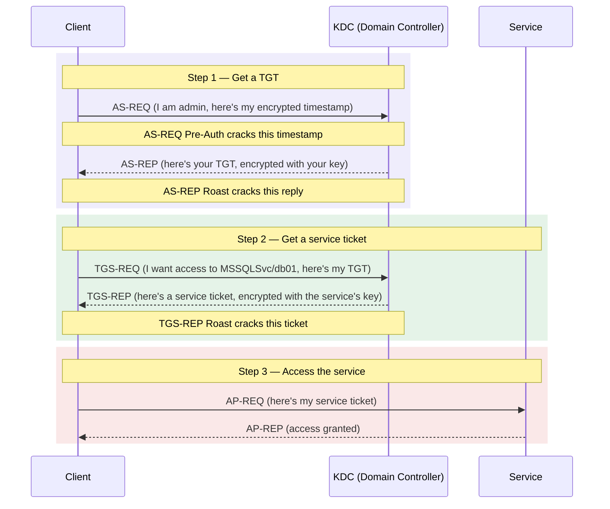

# Attacks

## What is Kerberos roasting?

When a user or service authenticates in Active Directory, the KDC hands out encrypted tickets. These tickets are encrypted with a key derived from the account's password. Get your hands on one of those encrypted blobs and you can try to crack the encryption offline by guessing passwords until one produces a key that decrypts correctly. That is roasting.

KerbWolf covers 4 attack types and 7 encryption types (including RFC 8009 AES-SHA2), producing 25 hash formats. hashcat has a mode for all of them except the six AES-SHA2 formats and the 120-byte MS-SNTP format. In addition to Kerberos, it extracts NTLM and MS-SNTP (timeroast) hashes from pcap captures.

The Kerberos authentication flow that we are targeting:

The three encrypted blobs in this flow (AS-REQ timestamp, AS-REP response, TGS-REP service ticket) can all be extracted and cracked offline. The fourth attack, timeroasting, does not use Kerberos at all: it asks a domain controller's time service for a hash.

## The four attacks at a glance

| | TGS-REP Roast | AS-REP Roast | AS-REQ Pre-Auth | Timeroasting |
|---|---|---|---|---|
| **Message** | TGS-REP ticket | AS-REP enc-part | AS-REQ padata | MS-SNTP response |
| **Path to the cipher** | `ticket` → `enc-part` → `EncryptedData.cipher` | `enc-part` → `EncryptedData.cipher` | `padata` → `PA-ENC-TIMESTAMP` → `EncryptedData.cipher` | Not ASN.1: the authenticator after the NTP header |
| **Keyed with** | Service account's long-term key | Client's long-term key | Client's long-term key | The account's NT hash |
| **Key usage** | 2 | 3; 8 for RC4-HMAC, per RFC 4757 | 1 | Not applicable |
| **Cracks to** | Service account's password | User's password | User's password | Computer, gMSA or trust account's password |
| **Auth needed** | Yes — you need a TGT (password, hash, or ccache) | No (for the attack itself). LDAP discovery of vulnerable accounts needs auth. | No (offline pcap parsing) | No, just a valid RID |
| **Source** | Live KDC request | Live KDC request | Packet capture | Live NTP request |
| **Prevalence** | Very common (any SPN account) | Rare (needs misconfiguration) | Depends on capture position | Pays off on weak machine and trust passwords |
| **Tool** | `kw-roast` | `kw-asrep` | `kw-extract` | `kw-timeroast` |
| **Hash prefix** | `$krb5tgs$` | `$krb5asrep$` | `$krb5pa$` | `$sntp-ms$`, `$sntp-ms-sha512$` |
| **Also read from a capture** | Yes, from a TGS-REP or an AP-REQ | Yes, every AS-REP | Capture only | Yes, port 123 |

The one exception to "auth needed" for TGS-REP: `--no-preauth` mode uses a DONT_REQ_PREAUTH account to request tickets via AS-REQ, bypassing authentication entirely.

!!! tip "Who owns the key?"
    AS-REQ and AS-REP target the **client's** key (user's password). TGS-REP targets the **service's** key (service account's password). Timeroasting targets **computer/trust account** NT hashes.

## TGS-REP Roast (Kerberoast)

Any domain user with a TGT can request a service ticket for any account that has a `servicePrincipalName`. The KDC encrypts that ticket with the service account's long-term key. Extract the encrypted portion, crack it offline, recover the service account's password.

Service accounts running SQL, IIS, Exchange tend to have weak passwords and domain admin privileges. One cracked service account often gets you the whole domain.

For AES and DES the ticket's key is salted with the account name, and a TGS-REP only names the service, so a hash labelled with an SPN has the wrong salt. KerbWolf therefore requests each ticket by the account's sAMAccountName rather than by SPN. How an SPN or a UPN given as a target is turned into that name is on the [kw-roast](../commands/kw-roast.md#behaviour) page.

## AS-REP Roast

Accounts with the `DONT_REQUIRE_PREAUTH` flag skip pre-authentication. Send an AS-REQ for one of them and the KDC sends back an AS-REP with a portion encrypted using the user's key. You don't need credentials to ask.

Rarer than SPN misconfigurations, but when you find one, the hash is free. For an account that does require pre-authentication, which is the normal case, the KDC answers with a KRB_ERROR (PREAUTH_REQUIRED) and the target is silently skipped: no hash.

## AS-REQ Pre-Auth

During normal authentication, the AS-REQ contains an encrypted timestamp (`PA-ENC-TIMESTAMP`) as proof of identity. Capture it off the wire via tcpdump, Wireshark, or traffic mirroring and you can crack it offline.

Nothing gets sent to the KDC. You just need visibility into port 88 traffic. Every user who authenticates with a password during your capture window produces a crackable hash. For AES and DES the user field has to carry the account's real spelling, not what the user typed: `kw-extract` takes it from the salt the KDC sends in the same exchange (the `PREAUTH_REQUIRED` error or the AS-REP), and falls back to the name as typed when the capture holds neither.

`kw-extract` also reads AS-REP and TGS-REP messages out of a capture, so all three hash types can be collected passively. The enc-part of every password-based AS-REP is encrypted with the client's key whether or not the account required pre-authentication (smartcard and FAST-armored logons use a different reply key and are not password-crackable), which makes each captured password logon crackable twice: once from the AS-REQ timestamp and once from the AS-REP.

## Timeroasting (MS-SNTP)

Domain controllers respond to authenticated NTP requests from computer, gMSA, and trust accounts. The response contains a hash keyed with the account's NT hash. No authentication is needed to request these hashes -- just a valid RID.

Which accounts answer, the two packet formats and what a DC really does with them are on the [Timeroasting](timeroasting.md) page.

## Read next

- [Timeroasting](timeroasting.md) - which accounts respond, packet formats, spec versus live behaviour
- [Encryption Types](encryption-types.md) - key derivation, salt, Windows version history
- [Hash Reference](../cracking/hash-reference.md) - modes, formats, cipher splitting, cracking examples
- [Cracking Speed](../cracking/speed.md) - measured hashcat rates per mode on an RTX 4090, and time to exhaust common keyspaces
