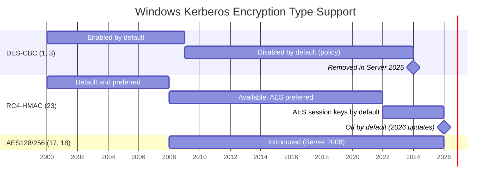

# Encryption Types

Seven Kerberos encryption types have been used in Active Directory. How each one derives its key determines what you're cracking and how fast.

```mermaid
flowchart LR
    P["Password"] --> DES_PATH & RC4_PATH & AES_PATH & SHA2_PATH

    subgraph DES_PATH["DES (etype 1, 3)"]
        direction TB
        D1["+ Salt: REALMusername"]
        D2["DES string-to-key"]
        D3["56-bit DES key"]
        D1 --> D2 --> D3
    end

    subgraph RC4_PATH["RC4 (etype 23)"]
        direction TB
        R1["UTF-16LE encode"]
        R2["MD4 hash"]
        R3["128-bit NT hash = key"]
        R1 --> R2 --> R3
    end

    subgraph AES_PATH["AES-SHA1 (etype 17, 18)"]
        direction TB
        A1["+ Salt: REALMusername"]
        A2["PBKDF2-SHA1<br/>4096 iterations"]
        A3["128 or 256-bit AES key"]
        A1 --> A2 --> A3
    end

    subgraph SHA2_PATH["AES-SHA2 (etype 19, 20)"]
        direction TB
        S1["+ Salt: etype_name + \\x00 + REALMusername"]
        S2["PBKDF2-SHA256/384<br/>4096 iterations"]
        S3["KDF-HMAC-SHA2"]
        S4["128 or 256-bit AES key"]
        S1 --> S2 --> S3 --> S4
    end

    style RC4_PATH fill:#4a2020,stroke:#ff6b6b
    style DES_PATH fill:#4a4a20,stroke:#ffd93d
    style AES_PATH fill:#1a3a1a,stroke:#6bcb77
    style SHA2_PATH fill:#1a2a3a,stroke:#6b9bcb
```

RC4 has **no salt** and uses a single fast hash (MD4). AES-SHA1 uses a salt, 4096 PBKDF2-HMAC-SHA1 iterations and a final DK step with the constant `kerberos`. AES-SHA2 adds an etype name prefix to the salt, switches PBKDF2 to SHA-256 or SHA-384, and replaces DK with KDF-HMAC-SHA2. DES uses a salt but has a tiny 56-bit keyspace.

---

## DES (etypes 1 and 3)

DES-CBC-CRC (etype 1) and DES-CBC-MD5 (etype 3) came from MIT Kerberos and shipped with Windows 2000. Both use 56-bit DES; they differ in the integrity check (CRC32 for etype 1, MD5 for etype 3) and in the CBC IV (the key itself for etype 1, zero for etype 3).

Both etypes produce the same key from the same password and salt. The key is only 56 bits, so in principle the key space itself can be searched no matter how long the password is. hashcat's Kerberos DES modes (38400, 38500, 38600, 39000, 39100, 39200, 39300) do not do that: they take password candidates, run the DES string-to-key on each with the `REALM` + `username` salt, and test the result, so they recover the password the same way the RC4 and AES modes do.

DES was disabled by default in Windows 7 and Server 2008 R2 (2009) and can be re-enabled there through the "Network security: Configure encryption types allowed for Kerberos" policy; the `USE_DES_KEY_ONLY` account flag then restricts an account to DES. It is removed in Server 2025.

| Property | Value |
|----------|-------|
| **Key size** | 56 bits effective (8 bytes with parity) |
| **Key derivation** | MIT DES string-to-key (password + salt) |
| **Salt** | `REALM` + `username` (e.g., `CONTOSO.COMAdmin`) |
| **Introduced** | Windows 2000 |
| **Disabled by default** | Windows 7 / Server 2008 R2 |
| **Removed** | Server 2025 |

## RC4-HMAC (etype 23)

Microsoft added RC4-HMAC in Windows 2000 to bridge NTLM and Kerberos. Key derivation: take the password, encode as UTF-16LE, MD4 hash it. Done. The result is the NT hash, and the NT hash **is** the RC4 key.

**There is no salt.** Same password, same key, regardless of username or domain. An NT hash pulled from one machine works as a Kerberos key on any DC in the domain. Pass-the-hash and overpass-the-hash both work because of this. The NT hash is completely portable.

The key derivation hashcat has to do per guess is a single `MD4(UTF-16LE(candidate))`, with no iterations. Each hash is still tested separately: modes 7500, 13100 and 18200 treat the ciphertext of every hash as its own salt, so a candidate is tried against each loaded hash in turn.

| Property | Value |
|----------|-------|
| **Key size** | 128 bits (16 bytes) |
| **Key derivation** | `MD4(UTF-16LE(password))` = NT hash |
| **Salt** | None |
| **Introduced** | Windows 2000 |
| **Deprecated** | RFC 8429 (2018); on Microsoft's deprecated-features list for Server 2025 |
| **Off by default** | Server 2025 KDCs no longer issue RC4 TGTs. The April 2026 updates (CVE-2026-20833, all supported DCs) change the default for accounts with no `msDS-SupportedEncryptionTypes` to AES-SHA1 only. RC4 still works where it is explicitly enabled |

## AES128 and AES256 (etypes 17 and 18)

AES128-CTS-HMAC-SHA1-96 (etype 17) and AES256-CTS-HMAC-SHA1-96 (etype 18) shipped with Vista and Server 2008. Key derivation uses PBKDF2-HMAC-SHA1 with 4096 iterations over a salted password, followed by the RFC 3962 DK step. Much slower to crack than RC4.

Same derivation for both, just different output length (16 bytes for AES128, 32 for AES256). AES256 is the default on modern domains.

| Property | AES128 (etype 17) | AES256 (etype 18) |
|----------|-------------------|-------------------|
| **Key size** | 16 bytes (128 bits) | 32 bytes (256 bits) |
| **Key derivation** | PBKDF2-HMAC-SHA1, 4096 iterations, then DK | Same |
| **Salt** | `REALM` + `username` | Same |
| **Introduced** | Server 2008 / Vista | Same |

!!! note "AES is slower to crack, not impossible"
    The 4096 PBKDF2 iterations make AES hundreds of times slower to crack than RC4 per candidate password. The exact gap depends on the device: in hashcat's own benchmark on the CPU used to check this page, mode 13100 ran roughly 200 times faster than mode 19700. But weak passwords are still weak. `Password1!` falls in seconds even with AES.

## AES128-SHA2 and AES256-SHA2 (etypes 19 and 20)

AES128-CTS-HMAC-SHA256-128 (etype 19) and AES256-CTS-HMAC-SHA384-192 (etype 20) are defined in RFC 8009. Windows 11 24H2 and Windows Server 2025 include them, disabled by default. They replace SHA1 with SHA2 in both key derivation and integrity checks.

Key derivation is a three-step process:

1. **Salt prefix**: prepend the full IANA etype name + `\x00` to the standard salt (e.g., `aes256-cts-hmac-sha384-192\x00CONTOSO.COMAdmin`)
2. **PBKDF2**: `PBKDF2-HMAC-SHA256` (etype 19) or `PBKDF2-HMAC-SHA384` (etype 20) with 4096 iterations (what Windows was observed to use; the RFC 8009 default is 32768)
3. **KDF-HMAC-SHA2**: SP 800-108 Counter Mode KDF with label `kerberos` to produce the final key

| Property | AES128-SHA2 (etype 19) | AES256-SHA2 (etype 20) |
|----------|------------------------|------------------------|
| **Key size** | 16 bytes (128 bits) | 32 bytes (256 bits) |
| **Key derivation** | PBKDF2-HMAC-SHA256, 4096 iterations + KDF | PBKDF2-HMAC-SHA384, 4096 iterations + KDF |
| **Salt** | `aes128-cts-hmac-sha256-128\x00REALM` + `username` | `aes256-cts-hmac-sha384-192\x00REALM` + `username` |
| **Integrity** | HMAC-SHA256-128 (16 bytes) | HMAC-SHA384-192 (24 bytes) |
| **Introduced** | Windows 11 24H2 / Server 2025, disabled by default |  Same |
| **RFC** | 8009 | Same |

!!! warning "Windows uses 4096 iterations, not 32768"
    RFC 8009 specifies a default of 32768 PBKDF2 iterations. Windows Server 2025 (build 26100) was observed to use 4096 instead, matching the AES-SHA1 iteration count, when the etypes were force-enabled on a lab DC. Microsoft does not document the count. KerbWolf's key derivation for etypes 19 and 20 uses 4096.

!!! note "Tool support for AES-SHA2"
    hashcat has no mode for etypes 19 and 20, so these hashes cannot be cracked with it today. In KerbWolf, the `-e` flag of `kw-roast`, `kw-asrep` and `kw-tgt` offers `des-cbc-crc`, `des-cbc-md5`, `rc4`, `aes128` and `aes256` only. AES-SHA2 hashes come from `kw-extract`, which formats any etype 19 or 20 message it finds in a capture.

---

## Salt computation

The salt is mixed into key derivation: appended to the password for DES, and passed as the PBKDF2 salt for AES. Same password on two different accounts = different keys. Computation varies by etype:

```mermaid
flowchart TD
    A{Which etype?} -->|"RC4 (23)"| B["No salt needed<br/>Key = MD4(UTF-16LE(password))"]
    A -->|"DES, AES-SHA1, AES-SHA2"| C{Account type?}

    C -->|"User account<br/>(e.g., Admin)"| D["Salt = REALM + username<br/>CONTOSO.COMAdmin"]
    C -->|"Computer account<br/>(e.g., DC01$)"| E["Salt = REALM + host + hostname.realm<br/>CONTOSO.COMhostdc01.contoso.com"]

    D & E --> S{"AES-SHA2 (19, 20)?"}
    S -->|Yes| S2["Prepend etype_name + \\x00"]
    S -->|No| F
    S2 --> F["Key = string-to-key(password, salt)"]
    B --> G["Key ready"]
    F --> G

    style B fill:#4a2020,stroke:#ff6b6b
    style G fill:#1a3a1a,stroke:#6bcb77
```

| Etype | Salt | Example |
|-------|------|---------|
| **DES** (1, 3) | `REALM` (uppercase) + `username` (case-preserved) | `CONTOSO.COMAdmin` |
| **RC4** (23) | **None** — the key is just `MD4(UTF-16LE(password))` | — |
| **AES-SHA1** (17, 18) | `REALM` (uppercase) + `username` (case-preserved) | `CONTOSO.COMAdmin` |
| **AES-SHA2** (19, 20) | `etype_name` + `\x00` + `REALM` + `username` | `aes256-cts-hmac-sha384-192\x00CONTOSO.COMAdmin` |

For **computer accounts** the salt changes. KerbWolf treats any sAMAccountName ending in `$` as one:

| Etype | Machine account salt | Example |
|-------|---------------------|---------|
| **DES / AES** | `REALM` + `host` + `hostname.realm` (all lowercase) | `CONTOSO.COMhostdc01.contoso.com` |

The salt matters because **hashcat needs it to derive the key**. For AES hashes, the username and realm in the hash string aren't just labels; they're cryptographic inputs. Wrong username or realm = wrong key = cracking silently fails even with the right password.

RC4 has no salt, which is why it cracks fast and why pass-the-hash works: the key depends on the password alone.

---

## msDS-SupportedEncryptionTypes

Each account's supported etypes are stored in the `msDS-SupportedEncryptionTypes` AD attribute. The KDC checks this bitmask when issuing tickets.

```mermaid
block-beta
    columns 5
    b4["Bit 4<br/>AES256<br/>0x10"]:1
    b3["Bit 3<br/>AES128<br/>0x08"]:1
    b2["Bit 2<br/>RC4<br/>0x04"]:1
    b1["Bit 1<br/>DES-MD5<br/>0x02"]:1
    b0["Bit 0<br/>DES-CRC<br/>0x01"]:1

    style b4 fill:#1a3a1a,stroke:#6bcb77
    style b3 fill:#1a3a1a,stroke:#6bcb77
    style b2 fill:#4a4a20,stroke:#ffd93d
    style b1 fill:#4a2020,stroke:#ff6b6b
    style b0 fill:#4a2020,stroke:#ff6b6b
```

| Bit | Value | Encryption type |
|-----|-------|-----------------|
| 0 | 0x01 | DES-CBC-CRC |
| 1 | 0x02 | DES-CBC-MD5 |
| 2 | 0x04 | RC4-HMAC |
| 3 | 0x08 | AES128-SHA1 |
| 4 | 0x10 | AES256-SHA1 |
| 5 | 0x20 | AES256-SHA1-SK: force AES session keys when RC4 or DES is otherwise allowed (in use since the November 2022 updates) |
| 6 | 0x40 | AES128-SHA2 |
| 7 | 0x80 | AES256-SHA2 |

Common values you'll see:

| Value | Meaning |
|-------|---------|
| **0** (not set) | KDC applies its `DefaultDomainSupportedEncTypes`: RC4 tickets historically, `0x27` (DES, RC4, AES session keys) after the November 2022 updates, `0x18` (AES-SHA1 only) on DCs with the April 2026 or later updates |
| **0x04** | RC4 only |
| **0x18** | AES128 + AES256 SHA1 (both "This account supports Kerberos AES 128/256 bit encryption" checkboxes in ADUC) |
| **0x1C** | RC4 + AES128 + AES256 SHA1 |
| **0x1F** | All five legacy encryption types |
| **0xF8** | AES128 + AES256 SHA1 + AES-SK + AES128-SHA2 + AES256-SHA2 (possible on Server 2025, not a default) |
| **0xFF** | All eight bits set: the seven encryption types plus the AES-session-key bit |

`kw-roast --ldap` queries for accounts with `servicePrincipalName` set. The KDC picks the etype for the ticket from the etypes in the request and the keys and settings of the service account, so a hash can come back with a different etype than the first one given to `-e`. A request the KDC cannot satisfy returns no ticket and the target is skipped: against a Server 2022 lab DC, `-e rc4` for an account limited to AES256 (`0x10`) produced nothing.

---

## Windows version timeline

| Version | Year | Supported etypes | Key change |
|---------|------|-----------------|------------|
| **Windows 2000** | 2000 | DES-CBC-CRC, DES-CBC-MD5, RC4-HMAC | Kerberos introduced to Windows. RC4 is the default. |
| **Server 2003** | 2003 | DES, RC4 | Last version without AES support. |
| **Server 2008** | 2008 | DES, RC4, AES128, AES256 | **AES introduced.** All five etypes available. |
| **Server 2008 R2** | 2009 | RC4, AES (DES disabled) | **DES disabled by default** (also Windows 7). Policy to re-enable. |
| **Server 2012 R2** | 2013 | RC4, AES | Protected Users group forces AES-only. |
| **Server 2022** | 2021 | RC4, AES | |
| **November 2022 updates** (all supported versions up to Server 2022) | 2022 | RC4, AES | CVE-2022-37966: AES becomes the default for session keys on accounts with no encryption types set. |
| **Server 2025** | 2024 | RC4 (deprecated), AES-SHA1; AES-SHA2 present but off by default | **DES removed.** The KDC no longer issues RC4 TGTs. |
| **April 2026 updates** (Server 2012 to 2025) | 2026 | AES-SHA1 by default | CVE-2026-20833: accounts with no encryption types set default to AES-SHA1 only (`0x18`). RC4 still works where explicitly enabled. |
