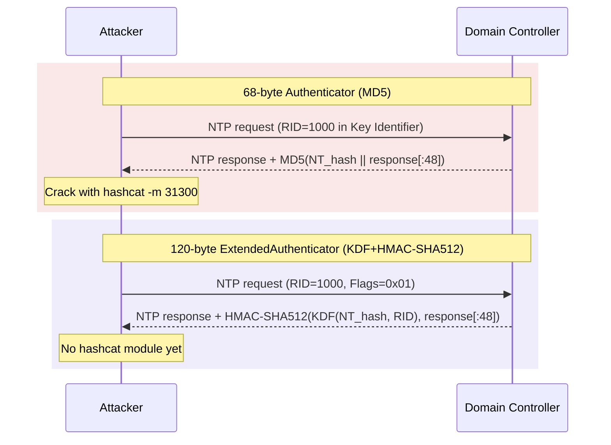

# Timeroasting

Timeroasting abuses Microsoft's NTP authentication extension (MS-SNTP) to extract crackable hashes, keyed with the account's NT hash, from domain controllers without any authentication. It targets computer, gMSA and trust accounts.

Machine account passwords are normally long and random, so the attack pays off on the exceptions: pre-created or pre-Windows 2000 computer accounts, manually set passwords, and trust accounts.

Two tools produce these hashes. [`kw-timeroast`](../commands/kw-timeroast.md) requests them from a DC, and [`kw-extract`](../commands/kw-extract.md) reads them out of a capture of port 123.

## Which accounts respond

Tested on Windows Server 2022 (Build 20348) and Server 2025 (Build 26100):

| Account type | objectClass | Timeroastable |
|---|---|---|
| **Computer** | computer | **YES** |
| **gMSA** | msDS-GroupManagedServiceAccount | **YES** |
| **Trust account** | user (INTERDOMAIN_TRUST_ACCOUNT) | **YES** (RID scan only — not in LDAP filter) |
| MSA | msDS-ManagedServiceAccount | No |
| dMSA | msDS-DelegatedManagedServiceAccount | No |
| User (even with `$` in name) | user | No |

The LDAP filter behind `kw-timeroast --ldap` is on the [Common options](../commands/common-options.md#ldap-target-discovery) page.

## How it works

Domain-joined Windows machines authenticate their NTP time sync requests using a hash derived from the machine account's NT password. A DC will compute and return this hash for **any valid computer or gMSA RID** -- no credentials are needed, just a valid RID.



## Two packet formats

| Format | Size | Algorithm | Hash line | Hashcat | Windows support |
|--------|------|-----------|-----------|---------|----------------|
| Authenticator | 68 bytes | <code>MD5(NTOWFv1 &#124;&#124; salt)</code> | `$sntp-ms$<hash>$<salt>` | Mode 31300 | All versions |
| ExtendedAuthenticator | 120 bytes | KDF(SP800-108, HMAC-SHA512) + HMAC-SHA512 | `$sntp-ms-sha512$<RID>$<hash>$<salt>` | None | Server 2012+ |

The 68-byte format is the primary attack target because hashcat mode 31300 can crack it. The 120-byte format uses a stronger algorithm (KDF with the RID as context), but no hashcat module exists for it yet; the hashes are captured for future cracking.

## Password selection

- **68-byte**: Bit 31 of the Key Identifier selects current (0) or previous (1) password. Works correctly on all tested DCs.
- **120-byte**: The spec says Flags bit 0 (USE_OLDKEY_VERSION) selects old password, but the DC requires bit 0 to be set just to respond. No working mechanism to select current vs previous, so `kw-timeroast` sends the 120-byte request once per RID whatever `--password` says, and does not label those hashes by password age.

Per MS-SNTP Appendix A `<27>`/`<28>`: machine accounts do not keep password history. Only trust accounts can have a previous password. If no previous exists, the DC returns the current password for both selectors: against a lab DC, the current and previous hashes of the same accounts cracked to the same passwords.

## Spec versus live behaviour

Tested against Windows Server 2022 (Build 20348) and Server 2025 (Build 26100). Full 0-255 byte sweep of the 120-byte control fields:

| Byte | Field | Spec says | Live behavior |
|------|-------|-----------|---------------|
| 53 | Flags | 0x00 for current, 0x01 for old | **Bit 0 MUST be 1 or DC drops the packet** |
| 54 | ClientHashIDHints | NTLM_PWD_HASH (0x01) MUST be set or DC drops | **DC ignores** -- all 256 values work |
| 55 | SignatureHashID | Must be 0x00 in request | DC ignores -- all 256 values work |
| Response byte 55 | SignatureHashID | Server MUST set to 0x01 | **DC always returns 0x00** (confirmed bug) |

## Hash lines

**68-byte MD5** (hashcat 31300):

```
$sntp-ms$<32hex_MD5_digest>$<96hex_salt>
```

The RID is not part of the hash string. `kw-timeroast --rid-prefix` writes the account name or RID in front of each line for account mapping.

**120-byte KDF+HMAC-SHA512** (no hashcat module):

```
$sntp-ms-sha512$<RID>$<128hex_HMAC_SHA512_digest>$<96hex_salt>
```

The RID is a **required cracking input** -- it feeds the SP800-108 KDF as the Context parameter.

Field lengths and the KDF itself are on the [Hashcat Internals](../cracking/hashcat-internals.md#timeroasting-ms-sntp) page.
