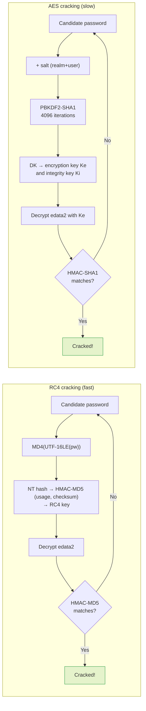

# Hash Reference

Which hashcat mode loads each line KerbWolf writes, and what the line has to look like.

KerbWolf writes 25 hash formats: 21 Kerberos, 2 MS-SNTP and 2 NTLM. hashcat has a mode for 18 of them. Two different things on this page are counted as 21. KerbWolf's 21 Kerberos formats are three attacks across seven etypes, and the six for etypes 19 and 20 have no mode. hashcat's 21 Kerberos modes are the other fifteen, plus three for DB keys and three that take NT hashes as candidates.

See also: [encryption types](../background/encryption-types.md) for key derivation details, [attacks](../background/attacks.md) for protocol walkthroughs.

## Mode matrix

|  | DES-CBC-CRC (1) | DES-CBC-MD5 (3) | AES128-SHA1 (17) | AES256-SHA1 (18) | AES128-SHA2 (19) | AES256-SHA2 (20) | RC4 (23) |
|---|---|---|---|---|---|---|---|
| **TGS-REP** | 39100 `$krb5tgs$1$` | 38500 `$krb5tgs$3$` | 19600 `$krb5tgs$17$` | 19700 `$krb5tgs$18$` | none | none | 13100 `$krb5tgs$23$` |
| **AS-REP** | 39200 `$krb5asrep$1$` | 38600 `$krb5asrep$3$` | 32100 `$krb5asrep$17$` | 32200 `$krb5asrep$18$` | none | none | 18200 `$krb5asrep$23$` |
| **Pre-Auth** | 39300 `$krb5pa$1$` | 39000 `$krb5pa$3$` | 19800 `$krb5pa$17$` | 19900 `$krb5pa$18$` | none | none | 7500 `$krb5pa$23$` |
| **DB Key** | 38400 `$krb5db$1$` | 38400 `$krb5db$3$` | 28800 `$krb5db$17$` | 28900 `$krb5db$18$` | none | none | 1000 (NT hash) |

These are the 21 Kerberos modes in hashcat master as of 2026-11-25, plus mode 1000 for the etype 23 database key. Modes 35300, 35400, 38400, 38500 and 38600 first shipped in hashcat v8.0.0; 39000 through 39400 were added after that release, so they need a build from master.

!!! warning "Build hashcat from master"
    KerbWolf writes the `$user$realm$` layout. hashcat added that layout to modes 7500, 13100, 18200, 19800, 19900, 35300, 35400 and 38500 on 2026-11-04, after the v8.0.0 release. A v8.0.0 build loads KerbWolf's lines only in modes 19600, 19700, 32100, 32200 and 38600; in the other eight it rejects them with `Token length exception`, `Separator unmatched` or `Signature unmatched`, and it has no modes 39000 through 39400. Until the next release, build hashcat from its master branch.

!!! warning "No hashcat mode for AES-SHA2"
    hashcat has no mode for etypes 19 and 20 (RFC 8009). KerbWolf still extracts those hashes from pcaps and writes them in the canonical layout, but nothing in hashcat loads them.

What each row holds:

| Row | Source | Description | Written by |
|---|---|---|---|
| **TGS-REP** (Kerberoast) | TGS-REP `ticket.enc-part` (or the ticket in an AS-REP when roasting with `--no-preauth`) | Service ticket encrypted with the service account's long-term key | `kw-roast`, `kw-extract` |
| **AS-REP** (AS-REP Roast) | AS-REP `enc-part` | Reply part encrypted with the client's key; free to request for accounts with pre-auth disabled, and present in any captured password logon | `kw-asrep`, `kw-extract` |
| **Pre-Auth** (AS-REQ) | `PA-ENC-TIMESTAMP` | Encrypted timestamp from pre-authentication, captured from network traffic | `kw-extract` |
| **DB Key** | `supplementalCredentials` / NTDS.dit | Long-term key stored in the KDC database | hashcat's `tools/krb5db2hashcat.py`, not KerbWolf |

Mode 38400 handles etypes 1, 2, and 3 in one module (same DES string-to-key). RC4 DB key is the NT hash itself (mode 1000).

### NT-hash variants (etype 23 only)

Same canonical line and the same ciphertext as the RC4 password modes, but the candidates are 32-char NT hashes instead of passwords: these modes crack the NT hash directly. Mode 39400 takes the same lines as 7500 except its single-field shape.

| Attack | NT Mode | Password Mode |
|---|---|---|
| TGS-REP | 35300 | 13100 |
| AS-REP | 35400 | 18200 |
| Pre-Auth | 39400 | 7500 |

### Other output

The lines that are not Kerberos. [`kw-extract`](../commands/kw-extract.md#what-it-extracts) writes all of them, and [`kw-timeroast`](../commands/kw-timeroast.md) the first two.

| Line | What it is | Hashcat mode |
|---|---|---|
| `$sntp-ms$...` | [MS-SNTP](../background/timeroasting.md#two-packet-formats) 68-byte Authenticator | 31300 |
| `$sntp-ms-sha512$...` | MS-SNTP 120-byte ExtendedAuthenticator | none |
| `user::domain:...` | Net-NTLMv1 / NTLMv1-ESS | 5500 |
| `user::domain:...` | Net-NTLMv2 / LMv2 | 5600 |
| `dn:password` | LDAP simple bind | cleartext, nothing to crack |

---

## Running hashcat

One mode per hash type and etype, picked from the matrix:

```bash
hashcat -m 13100 hashes.txt wordlist.txt      # RC4 TGS-REP
hashcat -m 19700 hashes.txt wordlist.txt      # AES256-SHA1 TGS-REP
hashcat -m 38400 hashes.txt wordlist.txt      # DES DB key (etypes 1, 2, 3)
hashcat -m 35300 hashes.txt nt-hashes.txt     # NT-hash variant: wordlist of 32-hex NT hashes
```

The three RC4 password modes (7500, 13100, 18200) run faster with `-O`; what that buys, and how long each etype takes, is on the [Cracking Speed](speed.md) page.

---

## Line format

All etypes use the same field layout, except DES pre-auth, which has one cipher field. This is what KerbWolf outputs for the TGS-REP, AS-REP and Pre-Auth hashes, and what every Kerberos mode of hashcat master accepts (v8.0.0 [does not](#mode-matrix)). hashcat prints a cracked hash back in the shape it was loaded in, so a canonical line stays canonical and a legacy line stays legacy.

**TGS-REP / AS-REP (enc-part hashes):**

```
$krb5tgs$<etype>$<user>$<realm>$<checksum_hex>$<edata2_hex>
$krb5asrep$<etype>$<user>$<realm>$<checksum_hex>$<edata2_hex>
```

**Pre-Auth (encrypted timestamp):**

```
$krb5pa$<etype>$<user>$<realm>$<checksum_hex>$<encrypted_hex>     (etypes 17, 18, 19, 20, 23)
$krb5pa$<etype>$<user>$<realm>$<cipher_hex>                       (etypes 1, 3)
```

!!! note "Pre-auth data fields"
    For RC4 and AES, KerbWolf splits the PA-ENC-TIMESTAMP cipher the same way as the enc-part hashes: the checksum is the first 16 bytes for RC4 and the last 12 bytes for AES-SHA1, and it is written before the encrypted timestamp. For DES the whole cipher goes out as one hex field, because the integrity check sits inside the plaintext. Modes 39300 and 39000 also accept the cipher split after its first 32 hex chars.

**DB Key (stored key from KDC database):**

```
$krb5db$<etype>$<user>$<realm>$<key_hex>
```

KerbWolf does not produce DB key lines. They come from hashcat's `tools/krb5db2hashcat.py`, which turns secretsdump, gosecretsdump, mimikatz, DSInternals and ntdissector output into these lines. An account's etype 1 and etype 3 keys are the same DES key, so loading both lines into mode 38400 counts as one hash. The etype 23 key is not a `$krb5db$` line: it is the bare NT hash, 32 hex, for mode 1000.

For RC4 the `user` and `realm` fields are metadata only. For every other etype they are part of the salt, and a wrong one means the hash never cracks: see [Troubleshooting](../troubleshooting.md#the-user-field-is-a-cryptographic-input). Whatever the etype, a user field that ends in `$` (a machine account name) makes hashcat reject the line, because `$` separates the fields.

The SPN is not in the canonical format. It is operational metadata that does not feed any crypto. KerbWolf stores it in the result record but does not include it in the hash output.

---

## How the cipher is split

Kerberos message comes in, ASN.1 gets decoded, cipher bytes get pulled out, split by etype, hex-encoded, and written as a hashcat string.

Where the checksum lives depends on the etype, not on which attack produced it. RC4 puts the checksum first and AES puts it last. DES has no separate checksum: it is encrypted inside the plaintext, and the first 16 cipher bytes are split off only to keep the same line layout. The checksum size varies: 16 bytes for RC4, 12 for AES-SHA1, 16 for AES128-SHA2, 24 for AES256-SHA2.

| Etype | Cipher layout | Checksum | Hex chars | Edata2 | Verification |
|-------|--------------|----------|-----------|--------|---------------------|
| **RC4** (23) | <code>checksum &#124;&#124; edata2</code> | First 16 bytes, HMAC-MD5 (RFC 4757) | 32 | Remaining bytes | Derive NT hash → RC4 key → decrypt → check HMAC over the plaintext |
| **AES128-SHA1** (17) | <code>edata2 &#124;&#124; checksum</code> | Last 12 bytes, HMAC-SHA1-96, which is HMAC-SHA1 truncated (RFC 3962) | 24 | All but last 12 bytes | PBKDF2 + DK → Ke, Ki → decrypt → check HMAC over the plaintext |
| **AES256-SHA1** (18) | <code>edata2 &#124;&#124; checksum</code> | Last 12 bytes, HMAC-SHA1-96 (RFC 3962) | 24 | All but last 12 bytes | Same as AES128-SHA1, longer key |
| **AES128-SHA2** (19) | <code>edata2 &#124;&#124; checksum</code> | Last 16 bytes, HMAC-SHA256-128 (RFC 8009) | 32 | All but last 16 bytes | PBKDF2-SHA256 + KDF → integrity key Ki → check HMAC over the ciphertext, no decryption needed (no hashcat mode) |
| **AES256-SHA2** (20) | <code>edata2 &#124;&#124; checksum</code> | Last 24 bytes, HMAC-SHA384-192 (RFC 8009) | 48 | All but last 24 bytes | PBKDF2-SHA384 + KDF → integrity key Ki → check HMAC over the ciphertext, no decryption needed (no hashcat mode) |
| **DES** (1, 3) | <code>checksum &#124;&#124; edata2</code> | First 16 bytes: the first 2 DES cipher blocks, a fixed split, not a checksum | 32 | Remaining bytes | String-to-key → DES key → decrypt → integrity check (CRC32 for etype 1, MD5 for etype 3) |

!!! tip "The etype determines the format, the attack determines the source"
    The split (where the checksum lives, how many bytes) is the same for all three attacks at the same etype, with one exception: DES pre-auth (etypes 1 and 3) is written as a single unsplit cipher field. Otherwise the only thing the attack type changes is *which ASN.1 field* the cipher is extracted from, and those paths are in the [attack comparison](../background/attacks.md#the-four-attacks-at-a-glance).

### Walkthrough: RC4 TGS-REP

You Kerberoasted an account and got a TGS-REP. What happens next:

**Step 1: Extract the cipher.** The TGS-REP is an ASN.1 structure. Inside it: `ticket` → `enc-part` → `etype` (23) and `cipher` (raw bytes). The cipher is the encrypted `EncTicketPart` (the service account's key was used to encrypt it).

**Step 2: Split the cipher.** For RC4 (etype 23), the cipher is structured as `checksum || edata2`:

- **Checksum**: the first 16 bytes — an HMAC-MD5 over the plaintext (an 8-byte confounder plus the `EncTicketPart`), which also keys the RC4 encryption
- **Edata2**: everything after the first 16 bytes — the actual encrypted ticket data

**Step 3: Format the hash.** Hex-encode both parts and arrange them into the hashcat format:

```
$krb5tgs$23$svc_sql$CORP.LOCAL$<checksum_32hex>$<edata2_hex>
```

**Step 4: Hashcat cracks it.** For each candidate password, hashcat computes `MD4(UTF-16LE(password))` to get an NT hash, derives the RC4 key from it (HMAC-MD5 with the key-usage number, then HMAC-MD5 with the checksum), decrypts `edata2`, and checks whether the HMAC-MD5 of the decrypted data matches `checksum`. If it matches, the password is found.



---

## Legacy and variant formats

hashcat accepts these other shapes on input and prints a cracked hash back in the shape it was loaded in; only an optional `*spn*` field is dropped. Other tools (Rubeus, Impacket, John the Ripper) may emit these instead of the canonical format. Field lengths and detection rules are on the [Hashcat Internals](hashcat-internals.md) page.

| Modes | Also accepted |
|---|---|
| 13100, 35300 | `$krb5tgs$23$*user$realm$spn*$checksum$edata2` (Rubeus/Impacket) |
| 13100, 35300 | `$krb5tgs$23$checksum$edata2` (bare) |
| 13100, 35300 | `$krb5tgs$spn:checksum$edata2` (JtR) |
| 18200, 35400 | `$krb5asrep$23$user@realm:checksum$edata2` (Impacket) |
| 18200, 35400 | `$krb5asrep$user@realm:checksum$edata2` (no etype) |
| 19600, 19700 | `$krb5tgs$E$user$realm$*spn*$checksum$edata2` (optional SPN) |
| 32100, 32200 | `$krb5asrep$E$salt$edata2$checksum` (JtR, fields reordered) |
| 38500, 39100 | `$krb5tgs$E$*user$realm$spn*$checksum$edata2` (asterisk block) |
| 38600, 39200 | `$krb5asrep$E$user@realm:checksum$edata2` (joined) |
| 7500 | `$krb5pa$23$user$realm$salt$encrypted+checksum` (salt field) |
| 7500 | `$krb5pa$23$user$realm$encrypted+checksum` (single field) |
| 39400 | `$krb5pa$23$user$realm$salt$encrypted+checksum` (salt field) |
| 19800, 19900 | `$krb5pa$E$user$realm$encrypted+checksum` (single field) |
| 19800, 19900 | `$krb5pa$E$user$realm$$encrypted+checksum` (empty salt, JtR) |
| 19800, 19900 | `$krb5pa$E$user$realm$salt$encrypted+checksum` (explicit salt) |
| 39000, 39300 | `$krb5pa$E$user$realm$checksum$encrypted` (cipher split after 32 hex) |
| 28800, 28900, 38400 | `$krb5db$E$user$realm$*spn*$key` (optional SPN) |

The `*user$realm$spn*` wrapper appears in the RC4 and DES TGS-REP output of other tools (Impacket's `GetUserSPNs.py` writes it for both); their AES output uses a separate `$*spn*$` field instead. KerbWolf never emits either.
