# Hash Reference

Hashcat modes, hash string formats, cipher splitting, cracking examples, and John the Ripper format for all Kerberos encryption types.

See also: [encryption types](encryption-types.md) for key derivation details, [attacks](attacks.md) for protocol walkthroughs.

## Mode matrix

|  | DES-CBC-CRC (1) | DES-CBC-MD5 (3) | AES128-SHA1 (17) | AES256-SHA1 (18) | AES128-SHA2 (19) | AES256-SHA2 (20) | RC4 (23) |
|---|---|---|---|---|---|---|---|
| **TGS-REP** | 39100 `$krb5tgs$1$` | 38500 `$krb5tgs$3$` | 19600 `$krb5tgs$17$` | 19700 `$krb5tgs$18$` | 39400 `$krb5tgs$19$` | 39500 `$krb5tgs$20$` | 13100 `$krb5tgs$23$` |
| **AS-REP** | 39200 `$krb5asrep$1$` | 38600 `$krb5asrep$3$` | 32100 `$krb5asrep$17$` | 32200 `$krb5asrep$18$` | 39600 `$krb5asrep$19$` | 39700 `$krb5asrep$20$` | 18200 `$krb5asrep$23$` |
| **Pre-Auth** | 39300 `$krb5pa$1$` | 39000 `$krb5pa$3$` | 19800 `$krb5pa$17$` | 19900 `$krb5pa$18$` | 39800 `$krb5pa$19$` | 39900 `$krb5pa$20$` | 7500 `$krb5pa$23$` |
| **DB Key** | 38400 `$krb5db$1$` | 38400 `$krb5db$3$` | 28800 `$krb5db$17$` | 28900 `$krb5db$18$` | 39010 `$krb5db$19$` | 39020 `$krb5db$20$` | -- |

### NT-hash variants (etype 23 only)

Same hash format as the password modes, but the input is a 32-char NT hash instead of a password.

| Attack | NT Mode | Password Mode |
|---|---|---|
| TGS-REP | 35300 | 13100 |
| AS-REP | 35400 | 18200 |
| Pre-Auth | 35900 | 7500 |

---

## From packet to hash

Kerberos message comes in, ASN.1 gets decoded, cipher bytes get pulled out, split by etype, hex-encoded, and written as a hashcat/John string.

```mermaid
flowchart TD
    A["Kerberos message<br/>(AS-REQ, AS-REP, or TGS-REP)"] --> B["Decode ASN.1 structure"]
    B --> C["Locate EncryptedData field"]
    C --> D["Read etype + cipher bytes"]
    D --> E{Which etype?}

    E -->|"RC4 (23)"| F["Split: first 16 bytes = checksum<br/>remaining = edata2"]
    E -->|"AES-SHA1 (17/18)"| G["Split: last 12 bytes = checksum<br/>remaining = edata2"]
    E -->|"AES-SHA2 (19)"| G2["Split: last 16 bytes = checksum<br/>remaining = edata2"]
    E -->|"AES-SHA2 (20)"| G3["Split: last 24 bytes = checksum<br/>remaining = edata2"]
    E -->|"DES (1/3)"| H["Split: first 16 bytes = checksum<br/>remaining = edata2"]
    G2 --> J
    G3 --> J

    F --> I["Format: $krb5tgs$23$user$realm$checksum$edata2"]
    G --> J["Format: $krb5tgs$18$user$realm$checksum$edata2"]
    H --> K["Format: $krb5tgs$3$user$realm$checksum$edata2"]

    I & J & K --> L["hashcat / john"]
    L --> M["Cracked password or DES key"]

    style E fill:#2a2a4a,stroke:#8b8bff
    style L fill:#1a3a1a,stroke:#6bcb77
    style M fill:#3a1a1a,stroke:#ff6b6b
```



### Walkthrough: RC4 TGS-REP

You Kerberoasted an account and got a TGS-REP. What happens next:

**Step 1: Extract the cipher.** The TGS-REP is an ASN.1 structure. Inside it: `ticket` → `enc-part` → `etype` (23) and `cipher` (raw bytes). The cipher is the encrypted `EncTicketPart` (the service account's key was used to encrypt it).

**Step 2: Split the cipher.** For RC4 (etype 23), the cipher is structured as `checksum || edata2`:

- **Checksum**: the first 16 bytes — an HMAC-MD5 over the encrypted data
- **Edata2**: everything after the first 16 bytes — the actual encrypted ticket data

**Step 3: Format the hash.** Hex-encode both parts and arrange them into the hashcat format:

```
$krb5tgs$23$svc_sql$CORP.LOCAL$<checksum_32hex>$<edata2_hex>
```

**Step 4: Hashcat cracks it.** For each candidate password, hashcat computes `MD4(UTF-16LE(password))` to get an NT hash, uses it to decrypt `edata2`, and checks whether the HMAC-MD5 matches `checksum`. If it matches, the password is found.

```mermaid
flowchart LR
    subgraph RC4["RC4 cracking (fast)"]
        direction TB
        R1["Candidate password"] --> R2["MD4(UTF-16LE(pw))"]
        R2 --> R3["NT hash = RC4 key"]
        R3 --> R4["Decrypt edata2"]
        R4 --> R5{"HMAC-MD5<br/>matches?"}
        R5 -->|Yes| R6["Cracked!"]
        R5 -->|No| R1
    end

    subgraph AES["AES cracking (slow)"]
        direction TB
        A1["Candidate password"] --> A2["+ salt (realm+user)"]
        A2 --> A3["PBKDF2-SHA1<br/>4096 iterations"]
        A3 --> A4["AES key"]
        A4 --> A5["Decrypt edata2"]
        A5 --> A6{"HMAC-SHA1<br/>matches?"}
        A6 -->|Yes| A7["Cracked!"]
        A6 -->|No| A1
    end

    style R6 fill:#1a3a1a,stroke:#6bcb77
    style A7 fill:#1a3a1a,stroke:#6bcb77
```



---

## How the split differs by etype

Where the checksum lives depends on the etype, not on which attack produced it. RC4 and DES put the checksum first; AES puts it last. The checksum size varies: 12 bytes for AES-SHA1, 16 for AES128-SHA2, 24 for AES256-SHA2.

```mermaid
block-beta
    columns 6

    block:rc4label:1
        rc4t["RC4<br/>(etype 23)"]
    end
    block:rc4check:2
        rc4c["Checksum (16 bytes)<br/>HMAC-MD5"]
    end
    block:rc4data:3
        rc4d["Edata2 (remaining bytes)<br/>RC4-encrypted data"]
    end

    block:aeslabel:1
        aest["AES<br/>(etype 17/18)"]
    end
    block:aesdata:4
        aesd["Edata2 (N − 12 bytes)<br/>AES-CTS encrypted data"]
    end
    block:aescheck:1
        aesc["Checksum<br/>(12 bytes)"]
    end

    block:deslabel:1
        dest["DES<br/>(etype 1/3)"]
    end
    block:descheck:2
        desc["Checksum (16 bytes)<br/>first two DES blocks"]
    end
    block:desdata:3
        desd["Edata2 (remaining bytes)<br/>DES-CBC encrypted data"]
    end

    style rc4check fill:#4a2020,stroke:#ff6b6b
    style rc4data fill:#1a3a3a,stroke:#6bcbcb
    style aesdata fill:#1a3a3a,stroke:#6bcbcb
    style aescheck fill:#4a2020,stroke:#ff6b6b
    style descheck fill:#4a2020,stroke:#ff6b6b
    style desdata fill:#1a3a3a,stroke:#6bcbcb
```



| Etype | Cipher layout | Checksum | Edata2 | Hashcat verification |
|-------|--------------|----------|--------|---------------------|
| **RC4** (23) | `checksum \|\| edata2` | First 16 bytes (HMAC-MD5) | Remaining bytes | Derive NT hash → decrypt → check HMAC |
| **AES128-SHA1** (17) | `edata2 \|\| checksum` | Last 12 bytes (HMAC-SHA1 truncated) | All but last 12 bytes | PBKDF2 → AES key → decrypt → check HMAC |
| **AES256-SHA1** (18) | `edata2 \|\| checksum` | Last 12 bytes (HMAC-SHA1 truncated) | All but last 12 bytes | Same as AES128-SHA1, longer key |
| **AES128-SHA2** (19) | `edata2 \|\| checksum` | Last 16 bytes (HMAC-SHA256-128) | All but last 16 bytes | PBKDF2-SHA256 + KDF → AES key → decrypt → check HMAC |
| **AES256-SHA2** (20) | `edata2 \|\| checksum` | Last 24 bytes (HMAC-SHA384-192) | All but last 24 bytes | PBKDF2-SHA384 + KDF → AES key → decrypt → check HMAC |
| **DES** (1, 3) | `checksum \|\| edata2` | First 16 bytes (first two DES blocks) | Remaining bytes | String-to-key → DES key → decrypt → integrity check (CRC32 for etype 1, MD5 for etype 3) |

!!! tip "The etype determines the format, the attack determines the source"
    The hash format (where the checksum lives, how many bytes) is the same for all three attacks at the same etype. The only thing the attack type changes is *which ASN.1 field* the cipher is extracted from.

### Where the cipher comes from (by attack type)

| Attack | Kerberos message | ASN.1 path to cipher |
|--------|-----------------|---------------------|
| **AS-REQ Pre-Auth** | AS-REQ | `padata` → `PA-ENC-TIMESTAMP` → `EncryptedData.cipher` |
| **AS-REP Roast** | AS-REP | `enc-part` → `EncryptedData.cipher` |
| **TGS-REP Roast** | TGS-REP | `ticket` → `enc-part` → `EncryptedData.cipher` |

---

## Hashcat format

### Canonical format

All etypes use the same field layout. This is what hashcat emits and what KerbWolf outputs.

**TGS-REP / AS-REP (enc-part hashes):**

```
$krb5tgs$<etype>$<user>$<realm>$<checksum_hex>$<edata2_hex>
$krb5asrep$<etype>$<user>$<realm>$<checksum_hex>$<edata2_hex>
```

**Pre-Auth (encrypted timestamp):**

```
$krb5pa$<etype>$<user>$<realm>$<data_hex>
```

**DB Key (stored key from KDC database):**

```
$krb5db$<etype>$<user>$<realm>$<key_hex>
```

### Checksum sizes

| Etype | Hex chars | Bytes | Algorithm |
|---|---|---|---|
| 1, 3 (DES) | 32 | 16 | First 2 DES blocks (split point for early reject) |
| 17, 18 (AES-SHA1) | 24 | 12 | HMAC-SHA1-96 (RFC 3962) |
| 19 (AES128-SHA2) | 32 | 16 | HMAC-SHA256-128 (RFC 8009) |
| 20 (AES256-SHA2) | 48 | 24 | HMAC-SHA384-192 (RFC 8009) |
| 23 (RC4) | 32 | 16 | HMAC-MD5 (RFC 4757) |

### Field roles

| Field | RC4 (23) | All other etypes |
|---|---|---|
| `etype` | Required (selects crypto) | Required |
| `user` | Metadata only | Required (case-sensitive, part of salt) |
| `realm` | Metadata only | Required (uppercased, part of salt) |
| `checksum` | Required, 32 hex | Required, size varies by etype |
| `edata2` | Required | Required |

The SPN is not in the canonical format. It is operational metadata that does not feed any crypto. KerbWolf emits it in log output alongside the hash.

### Format tables

#### TGS-REP Roast (`$krb5tgs$`)

| Etype | Mode | Format |
|-------|------|--------|
| RC4 (23) | 13100 | `$krb5tgs$23$user$realm$checksum$edata2` |
| AES128-SHA1 (17) | 19600 | `$krb5tgs$17$user$realm$checksum$edata2` |
| AES256-SHA1 (18) | 19700 | `$krb5tgs$18$user$realm$checksum$edata2` |
| AES128-SHA2 (19) | 39400 | `$krb5tgs$19$user$realm$checksum$edata2` |
| AES256-SHA2 (20) | 39500 | `$krb5tgs$20$user$realm$checksum$edata2` |
| DES-CBC-CRC (1) | 39100 | `$krb5tgs$1$user$realm$checksum$edata2` |
| DES-CBC-MD5 (3) | 38500 | `$krb5tgs$3$user$realm$checksum$edata2` |

#### AS-REP Roast (`$krb5asrep$`)

| Etype | Mode | Format |
|-------|------|--------|
| RC4 (23) | 18200 | `$krb5asrep$23$user$realm$checksum$edata2` |
| AES128-SHA1 (17) | 32100 | `$krb5asrep$17$user$realm$checksum$edata2` |
| AES256-SHA1 (18) | 32200 | `$krb5asrep$18$user$realm$checksum$edata2` |
| AES128-SHA2 (19) | 39600 | `$krb5asrep$19$user$realm$checksum$edata2` |
| AES256-SHA2 (20) | 39700 | `$krb5asrep$20$user$realm$checksum$edata2` |
| DES-CBC-CRC (1) | 39200 | `$krb5asrep$1$user$realm$checksum$edata2` |
| DES-CBC-MD5 (3) | 38600 | `$krb5asrep$3$user$realm$checksum$edata2` |

#### AS-REQ Pre-Auth (`$krb5pa$`)

| Etype | Mode | Format |
|-------|------|--------|
| RC4 (23) | 7500 | `$krb5pa$23$user$realm$data` |
| AES128-SHA1 (17) | 19800 | `$krb5pa$17$user$realm$data` |
| AES256-SHA1 (18) | 19900 | `$krb5pa$18$user$realm$data` |
| AES128-SHA2 (19) | 39800 | `$krb5pa$19$user$realm$data` |
| AES256-SHA2 (20) | 39900 | `$krb5pa$20$user$realm$data` |
| DES-CBC-CRC (1) | 39300 | `$krb5pa$1$user$realm$cipher` |
| DES-CBC-MD5 (3) | 39000 | `$krb5pa$3$user$realm$cipher` |

!!! note "Pre-auth data field"
    The pre-auth hash data is the full PA-ENC-TIMESTAMP cipher as a single hex field. For RC4, that is edata2 (72 hex chars) followed by checksum (32 hex chars). The John format adds an empty salt field (`$$`) between `realm` and the data; KerbWolf's hashcat format does not.

---

## John the Ripper format

Use `--format john` to output hashes for John. All 9 RC4/AES modes are verified cracking.

| Attack | Etype | John `--format=` | Notes |
|--------|-------|-----------------|-------|
| TGS-REP | RC4 | `krb5tgs` | `$krb5tgs$23$*user$realm$spn*$checksum$edata2` |
| TGS-REP | AES | `krb5tgs-sha1` | Same as hashcat canonical format |
| AS-REP | RC4 | `krb5asrep` | `$krb5asrep$23$checksum$edata2` (no user/realm fields) |
| AS-REP | AES | `krb5asrep` | `$REALMuser$edata2$checksum` (realm+user concatenated) |
| AS-REQ | RC4 | `krb5pa-md5` | `$krb5pa$23$user$realm$$edata2checksum` (empty salt field, edata2 before checksum) |
| AS-REQ | AES | `krb5pa-sha1` | Adds empty salt field: `$krb5pa$17$user$realm$$edata2checksum` |
| Any | DES-CBC-MD5 | `krb5-3` | `$krb3$REALMuser$cipher` |
| Any | DES-CBC-CRC | — | No native John support; falls back to hashcat format |

---

## Legacy and variant formats

hashcat accepts these older formats on input and silently converts to canonical on output. Other tools (Rubeus, Impacket, John the Ripper) may emit these instead of the canonical format.

| Etype | TGS-REP legacy | AS-REP legacy |
|---|---|---|
| 23 | `$krb5tgs$23$*user$realm$spn*$checksum$edata2` (Rubeus/JtR) | `$krb5asrep$23$user@realm:checksum$edata2` (Impacket) |
| 23 | `$krb5tgs$23$checksum$edata2` (bare) | `$krb5asrep$user@realm:checksum$edata2` (no etype) |
| 23 | `$krb5tgs$spn:checksum$edata2` (JtR) | |
| 17, 18 | (none — canonical is the only format) | `$krb5asrep$E$salt$edata2$checksum` (JtR, fields reordered) |

Pre-Auth legacy: `$krb5pa$E$user$realm$$data` (empty salt field between realm and data) and `$krb5pa$E$user$realm$salt$data` (JtR explicit salt).

DB Key legacy: `$krb5db$E$user$realm$*spn*$key` (with SPN).

The `*user$realm$spn*` wrapper only appears in John/Rubeus RC4 TGS-REP output. KerbWolf never emits it in hashcat mode. The SPN is not a cryptographic input — it is operational metadata logged alongside the hash.

---

## Cracking examples

```bash
# Hashcat — TGS-REP Roast
hashcat -m 13100 hashes.txt wordlist.txt    # RC4
hashcat -m 19600 hashes.txt wordlist.txt    # AES128-SHA1
hashcat -m 19700 hashes.txt wordlist.txt    # AES256-SHA1
hashcat -m 39400 hashes.txt wordlist.txt    # AES128-SHA2
hashcat -m 39500 hashes.txt wordlist.txt    # AES256-SHA2

# Hashcat — AS-REP Roast
hashcat -m 18200 hashes.txt wordlist.txt    # RC4
hashcat -m 32100 hashes.txt wordlist.txt    # AES128-SHA1
hashcat -m 32200 hashes.txt wordlist.txt    # AES256-SHA1
hashcat -m 39600 hashes.txt wordlist.txt    # AES128-SHA2
hashcat -m 39700 hashes.txt wordlist.txt    # AES256-SHA2

# Hashcat — AS-REQ Pre-Auth
hashcat -m 7500  hashes.txt wordlist.txt    # RC4
hashcat -m 19800 hashes.txt wordlist.txt    # AES128-SHA1
hashcat -m 19900 hashes.txt wordlist.txt    # AES256-SHA1
hashcat -m 39800 hashes.txt wordlist.txt    # AES128-SHA2
hashcat -m 39900 hashes.txt wordlist.txt    # AES256-SHA2

# John the Ripper
john --format=krb5tgs hashes.txt --wordlist=wordlist.txt           # TGS RC4
john --format=krb5tgs-sha1 hashes.txt --wordlist=wordlist.txt      # TGS AES
john --format=krb5asrep hashes.txt --wordlist=wordlist.txt         # AS-REP (auto)
john --format=krb5pa-md5 hashes.txt --wordlist=wordlist.txt        # AS-REQ RC4
john --format=krb5pa-sha1 hashes.txt --wordlist=wordlist.txt       # AS-REQ AES
```

---

## Attack types

| Attack | Source | Description |
|---|---|---|
| **TGS-REP** (Kerberoast) | TGS-REP `enc-part` | Service ticket encrypted with the service account's long-term key |
| **AS-REP** (AS-REP Roast) | AS-REP `enc-part` | Response to accounts with pre-auth disabled, encrypted with the client's key |
| **Pre-Auth** (AS-REQ) | `PA-ENC-TIMESTAMP` | Encrypted timestamp from pre-authentication, captured from network traffic |
| **DB Key** | `supplementalCredentials` / NTDS.dit | Long-term key stored in the KDC database |
| **NT-Hash variants** | Same ciphertext as RC4 modes | Cracks the NT hash directly instead of the password (etype 23 only) |

Mode 38400 handles etypes 1, 2, and 3 in one module (same DES string-to-key). RC4 DB key is the NT hash itself (mode 1000).

---

## Encryption type details

| Etype | IANA Name | Key Derivation | Cipher | Integrity | RFC | Status |
|---|---|---|---|---|---|---|
| 1 | des-cbc-crc | DES string-to-key | DES-CBC (IV=key) | CRC32 | 3961 | Deprecated |
| 3 | des-cbc-md5 | DES string-to-key | DES-CBC (IV=0) | MD5 | 3961 | Deprecated |
| 17 | aes128-cts-hmac-sha1-96 | PBKDF2-SHA1 + nfold DK | AES-128-CTS | HMAC-SHA1-96 | 3962 | |
| 18 | aes256-cts-hmac-sha1-96 | PBKDF2-SHA1 + nfold DK | AES-256-CTS | HMAC-SHA1-96 | 3962 | |
| 19 | aes128-cts-hmac-sha256-128 | PBKDF2-SHA256 + SP800-108 | AES-128-CTS | HMAC-SHA256-128 | 8009 | |
| 20 | aes256-cts-hmac-sha384-192 | PBKDF2-SHA384 + SP800-108 | AES-256-CTS | HMAC-SHA384-192 | 8009 | |
| 23 | rc4-hmac | MD4 (NT hash) | RC4 | HMAC-MD5 | 4757 | Deprecated |

For key derivation details (salt computation, PBKDF2 parameters, SHA2 string-to-key), see [Encryption Types](encryption-types.md).
