# Hash Reference

Hashcat modes, hash string formats, cipher splitting, and cracking examples for all Kerberos encryption types.

See also: [encryption types](encryption-types.md) for key derivation details, [attacks](attacks.md) for protocol walkthroughs.

## Mode matrix

|  | DES-CBC-CRC (1) | DES-CBC-MD5 (3) | AES128-SHA1 (17) | AES256-SHA1 (18) | AES128-SHA2 (19) | AES256-SHA2 (20) | RC4 (23) |
|---|---|---|---|---|---|---|---|
| **TGS-REP** | 39100 `$krb5tgs$1$` | 38500 `$krb5tgs$3$` | 19600 `$krb5tgs$17$` | 19700 `$krb5tgs$18$` | none | none | 13100 `$krb5tgs$23$` |
| **AS-REP** | 39200 `$krb5asrep$1$` | 38600 `$krb5asrep$3$` | 32100 `$krb5asrep$17$` | 32200 `$krb5asrep$18$` | none | none | 18200 `$krb5asrep$23$` |
| **Pre-Auth** | 39300 `$krb5pa$1$` | 39000 `$krb5pa$3$` | 19800 `$krb5pa$17$` | 19900 `$krb5pa$18$` | none | none | 7500 `$krb5pa$23$` |
| **DB Key** | 38400 `$krb5db$1$` | 38400 `$krb5db$3$` | 28800 `$krb5db$17$` | 28900 `$krb5db$18$` | none | none | 1000 (NT hash) |

These are the 21 Kerberos modes in hashcat master as of 2026-11-15, plus mode 1000 for the etype 23 database key. Modes 35300, 35400, 38400, 38500 and 38600 first shipped in hashcat v8.0.0; 39000 through 39400 were added after that release, so they need a build from master.

!!! warning "No hashcat mode for AES-SHA2"
    hashcat has no mode for etypes 19 and 20 (RFC 8009). KerbWolf still extracts those hashes from pcaps and writes them in the canonical layout, but nothing in hashcat loads them.

### NT-hash variants (etype 23 only)

Same canonical line as the password modes, but the candidates are 32-char NT hashes instead of passwords. Mode 39400 is narrower than 7500: it needs a 72-hex encrypted timestamp and does not take 7500's single-field shape.

| Attack | NT Mode | Password Mode |
|---|---|---|
| TGS-REP | 35300 | 13100 |
| AS-REP | 35400 | 18200 |
| Pre-Auth | 39400 | 7500 |

---

## From packet to hash

Kerberos message comes in, ASN.1 gets decoded, cipher bytes get pulled out, split by etype, hex-encoded, and written as a hashcat string.

```mermaid
flowchart TD
    A["Kerberos message<br/>(AS-REQ, AS-REP, or TGS-REP)"] --> B["Decode ASN.1 structure"]
    B --> C["Locate EncryptedData field"]
    C --> D["Read etype + cipher bytes"]
    D --> E{Which etype?}

    E -->|"RC4 (23)"| F["Split: first 16 bytes = checksum<br/>remaining = edata2"]
    E -->|"AES-SHA1 (17/18)"| G["Split: last 12 bytes = checksum<br/>remaining = edata2"]
    E -->|"AES-SHA2 (19)"| G2["Split: last 16 bytes = checksum<br/>remaining = edata2"]
    E -->|"AES-SHA2 (20)"| G3["Split: last 24 bytes = checksum<br/>remaining = edata2"]
    E -->|"DES (1/3)"| H["Split: first 16 bytes = checksum<br/>remaining = edata2"]
    G2 & G3 --> J2["Format: $krb5tgs$19$… / $krb5tgs$20$…<br/>(no hashcat mode)"]

    F --> I["Format: $krb5tgs$23$user$realm$checksum$edata2"]
    G --> J["Format: $krb5tgs$18$user$realm$checksum$edata2"]
    H --> K["Format: $krb5tgs$3$user$realm$checksum$edata2"]

    I & J & K --> L["hashcat"]
    L --> M["Cracked password"]

    style E fill:#2a2a4a,stroke:#8b8bff
    style L fill:#1a3a1a,stroke:#6bcb77
    style M fill:#3a1a1a,stroke:#ff6b6b
```



### Walkthrough: RC4 TGS-REP

You Kerberoasted an account and got a TGS-REP. What happens next:

**Step 1: Extract the cipher.** The TGS-REP is an ASN.1 structure. Inside it: `ticket` → `enc-part` → `etype` (23) and `cipher` (raw bytes). The cipher is the encrypted `EncTicketPart` (the service account's key was used to encrypt it).

**Step 2: Split the cipher.** For RC4 (etype 23), the cipher is structured as `checksum || edata2`:

- **Checksum**: the first 16 bytes — an HMAC-MD5 over the plaintext (an 8-byte confounder plus the `EncTicketPart`), which also keys the RC4 encryption
- **Edata2**: everything after the first 16 bytes — the actual encrypted ticket data

**Step 3: Format the hash.** Hex-encode both parts and arrange them into the hashcat format:

```
$krb5tgs$23$svc_sql$CORP.LOCAL$<checksum_32hex>$<edata2_hex>
```

**Step 4: Hashcat cracks it.** For each candidate password, hashcat computes `MD4(UTF-16LE(password))` to get an NT hash, derives the RC4 key from it (HMAC-MD5 with the key-usage number, then HMAC-MD5 with the checksum), decrypts `edata2`, and checks whether the HMAC-MD5 of the decrypted data matches `checksum`. If it matches, the password is found.

```mermaid
flowchart LR
    subgraph RC4["RC4 cracking (fast)"]
        direction TB
        R1["Candidate password"] --> R2["MD4(UTF-16LE(pw))"]
        R2 --> R3["NT hash → HMAC-MD5 (usage, checksum)<br/>→ RC4 key"]
        R3 --> R4["Decrypt edata2"]
        R4 --> R5{"HMAC-MD5<br/>matches?"}
        R5 -->|Yes| R6["Cracked!"]
        R5 -->|No| R1
    end

    subgraph AES["AES cracking (slow)"]
        direction TB
        A1["Candidate password"] --> A2["+ salt (realm+user)"]
        A2 --> A3["PBKDF2-SHA1<br/>4096 iterations"]
        A3 --> A4["DK → encryption key Ke<br/>and integrity key Ki"]
        A4 --> A5["Decrypt edata2 with Ke"]
        A5 --> A6{"HMAC-SHA1<br/>matches?"}
        A6 -->|Yes| A7["Cracked!"]
        A6 -->|No| A1
    end

    style R6 fill:#1a3a1a,stroke:#6bcb77
    style A7 fill:#1a3a1a,stroke:#6bcb77
```



---

## How the split differs by etype

Where the checksum lives depends on the etype, not on which attack produced it. RC4 puts the checksum first and AES puts it last. DES has no separate checksum: it is encrypted inside the plaintext, and the first 16 cipher bytes are split off only to keep the same line layout. The checksum size varies: 16 bytes for RC4, 12 for AES-SHA1, 16 for AES128-SHA2, 24 for AES256-SHA2.

```mermaid
block-beta
    columns 6

    block:rc4label:1
        rc4t["RC4<br/>(etype 23)"]
    end
    block:rc4check:2
        rc4c["Checksum (16 bytes)<br/>HMAC-MD5"]
    end
    block:rc4data:3
        rc4d["Edata2 (remaining bytes)<br/>RC4-encrypted data"]
    end

    block:aeslabel:1
        aest["AES<br/>(etype 17/18)"]
    end
    block:aesdata:4
        aesd["Edata2 (N − 12 bytes)<br/>AES-CTS encrypted data"]
    end
    block:aescheck:1
        aesc["Checksum<br/>(12 bytes)"]
    end

    block:deslabel:1
        dest["DES<br/>(etype 1/3)"]
    end
    block:descheck:2
        desc["Checksum (16 bytes)<br/>first two DES blocks"]
    end
    block:desdata:3
        desd["Edata2 (remaining bytes)<br/>DES-CBC encrypted data"]
    end

    style rc4check fill:#4a2020,stroke:#ff6b6b
    style rc4data fill:#1a3a3a,stroke:#6bcbcb
    style aesdata fill:#1a3a3a,stroke:#6bcbcb
    style aescheck fill:#4a2020,stroke:#ff6b6b
    style descheck fill:#4a2020,stroke:#ff6b6b
    style desdata fill:#1a3a3a,stroke:#6bcbcb
```



| Etype | Cipher layout | Checksum | Edata2 | Verification |
|-------|--------------|----------|--------|---------------------|
| **RC4** (23) | `checksum \|\| edata2` | First 16 bytes (HMAC-MD5) | Remaining bytes | Derive NT hash → RC4 key → decrypt → check HMAC over the plaintext |
| **AES128-SHA1** (17) | `edata2 \|\| checksum` | Last 12 bytes (HMAC-SHA1 truncated) | All but last 12 bytes | PBKDF2 + DK → Ke, Ki → decrypt → check HMAC over the plaintext |
| **AES256-SHA1** (18) | `edata2 \|\| checksum` | Last 12 bytes (HMAC-SHA1 truncated) | All but last 12 bytes | Same as AES128-SHA1, longer key |
| **AES128-SHA2** (19) | `edata2 \|\| checksum` | Last 16 bytes (HMAC-SHA256-128) | All but last 16 bytes | PBKDF2-SHA256 + KDF → integrity key Ki → check HMAC over the ciphertext, no decryption needed (no hashcat mode) |
| **AES256-SHA2** (20) | `edata2 \|\| checksum` | Last 24 bytes (HMAC-SHA384-192) | All but last 24 bytes | PBKDF2-SHA384 + KDF → integrity key Ki → check HMAC over the ciphertext, no decryption needed (no hashcat mode) |
| **DES** (1, 3) | `checksum \|\| edata2` | First 16 bytes (the first two cipher blocks, not a checksum) | Remaining bytes | String-to-key → DES key → decrypt → integrity check (CRC32 for etype 1, MD5 for etype 3) |

!!! tip "The etype determines the format, the attack determines the source"
    The split (where the checksum lives, how many bytes) is the same for all three attacks at the same etype, with one exception: DES pre-auth (etypes 1 and 3) is written as a single unsplit cipher field. Otherwise the only thing the attack type changes is *which ASN.1 field* the cipher is extracted from.

### Where the cipher comes from (by attack type)

| Attack | Kerberos message | ASN.1 path to cipher |
|--------|-----------------|---------------------|
| **AS-REQ Pre-Auth** | AS-REQ | `padata` → `PA-ENC-TIMESTAMP` → `EncryptedData.cipher` |
| **AS-REP Roast** | AS-REP | `enc-part` → `EncryptedData.cipher` |
| **TGS-REP Roast** | TGS-REP | `ticket` → `enc-part` → `EncryptedData.cipher` |

---

## Hashcat format

### Canonical format

All etypes use the same field layout, except DES pre-auth, which has one cipher field. This is what KerbWolf outputs for the TGS-REP, AS-REP and Pre-Auth hashes, and what every hashcat Kerberos mode accepts. hashcat prints a cracked hash back in the shape it was loaded in, so a canonical line stays canonical and a legacy line stays legacy.

**TGS-REP / AS-REP (enc-part hashes):**

```
$krb5tgs$<etype>$<user>$<realm>$<checksum_hex>$<edata2_hex>
$krb5asrep$<etype>$<user>$<realm>$<checksum_hex>$<edata2_hex>
```

**Pre-Auth (encrypted timestamp):**

```
$krb5pa$<etype>$<user>$<realm>$<checksum_hex>$<encrypted_hex>     (etypes 17, 18, 19, 20, 23)
$krb5pa$<etype>$<user>$<realm>$<cipher_hex>                       (etypes 1, 3)
```

**DB Key (stored key from KDC database):**

```
$krb5db$<etype>$<user>$<realm>$<key_hex>
```

KerbWolf does not produce DB key lines. They come from hashcat's `tools/krb5db2hashcat.py`, run on a credential dump.

### Checksum sizes

| Etype | Hex chars | Bytes | Algorithm |
|---|---|---|---|
| 1, 3 (DES) | 32 | 16 | First 2 DES cipher blocks (a fixed split, not a checksum) |
| 17, 18 (AES-SHA1) | 24 | 12 | HMAC-SHA1-96 (RFC 3962) |
| 19 (AES128-SHA2) | 32 | 16 | HMAC-SHA256-128 (RFC 8009) |
| 20 (AES256-SHA2) | 48 | 24 | HMAC-SHA384-192 (RFC 8009) |
| 23 (RC4) | 32 | 16 | HMAC-MD5 (RFC 4757) |

### Field roles

| Field | RC4 (23) | All other etypes |
|---|---|---|
| `etype` | Required (selects crypto) | Required |
| `user` | Metadata only | Required (case-sensitive, part of salt) |
| `realm` | Metadata only | Required (uppercased, part of salt) |
| `checksum` | Required, 32 hex | Required, size varies by etype |
| `edata2` | Required | Required |

The SPN is not in the canonical format. It is operational metadata that does not feed any crypto. KerbWolf stores it in the result record but does not include it in the hash output.

### Format tables

#### TGS-REP Roast (`$krb5tgs$`)

| Etype | Mode | Format |
|-------|------|--------|
| RC4 (23) | 13100 | `$krb5tgs$23$user$realm$checksum$edata2` |
| AES128-SHA1 (17) | 19600 | `$krb5tgs$17$user$realm$checksum$edata2` |
| AES256-SHA1 (18) | 19700 | `$krb5tgs$18$user$realm$checksum$edata2` |
| AES128-SHA2 (19) | none | `$krb5tgs$19$user$realm$checksum$edata2` |
| AES256-SHA2 (20) | none | `$krb5tgs$20$user$realm$checksum$edata2` |
| DES-CBC-CRC (1) | 39100 | `$krb5tgs$1$user$realm$checksum$edata2` |
| DES-CBC-MD5 (3) | 38500 | `$krb5tgs$3$user$realm$checksum$edata2` |

#### AS-REP Roast (`$krb5asrep$`)

| Etype | Mode | Format |
|-------|------|--------|
| RC4 (23) | 18200 | `$krb5asrep$23$user$realm$checksum$edata2` |
| AES128-SHA1 (17) | 32100 | `$krb5asrep$17$user$realm$checksum$edata2` |
| AES256-SHA1 (18) | 32200 | `$krb5asrep$18$user$realm$checksum$edata2` |
| AES128-SHA2 (19) | none | `$krb5asrep$19$user$realm$checksum$edata2` |
| AES256-SHA2 (20) | none | `$krb5asrep$20$user$realm$checksum$edata2` |
| DES-CBC-CRC (1) | 39200 | `$krb5asrep$1$user$realm$checksum$edata2` |
| DES-CBC-MD5 (3) | 38600 | `$krb5asrep$3$user$realm$checksum$edata2` |

#### AS-REQ Pre-Auth (`$krb5pa$`)

| Etype | Mode | Format |
|-------|------|--------|
| RC4 (23) | 7500 | `$krb5pa$23$user$realm$checksum$encrypted` |
| AES128-SHA1 (17) | 19800 | `$krb5pa$17$user$realm$checksum$encrypted` |
| AES256-SHA1 (18) | 19900 | `$krb5pa$18$user$realm$checksum$encrypted` |
| AES128-SHA2 (19) | none | `$krb5pa$19$user$realm$checksum$encrypted` |
| AES256-SHA2 (20) | none | `$krb5pa$20$user$realm$checksum$encrypted` |
| DES-CBC-CRC (1) | 39300 | `$krb5pa$1$user$realm$cipher` |
| DES-CBC-MD5 (3) | 39000 | `$krb5pa$3$user$realm$cipher` |

!!! note "Pre-auth data fields"
    For RC4 and AES, KerbWolf splits the PA-ENC-TIMESTAMP cipher the same way as the enc-part hashes: the checksum is the first 16 bytes for RC4 and the last 12 bytes for AES-SHA1, and it is written before the encrypted timestamp. For DES the whole cipher goes out as one hex field, because the integrity check sits inside the plaintext. Modes 39300 and 39000 also accept the cipher split after its first 32 hex chars.

#### DB Key (`$krb5db$`)

| Etype | Mode | Format |
|-------|------|--------|
| DES-CBC-CRC (1) | 38400 | `$krb5db$1$user$realm$key` |
| DES-CBC-MD5 (3) | 38400 | `$krb5db$3$user$realm$key` |
| AES128-SHA1 (17) | 28800 | `$krb5db$17$user$realm$key` |
| AES256-SHA1 (18) | 28900 | `$krb5db$18$user$realm$key` |
| RC4 (23) | 1000 | Bare NT hash, 32 hex |

An account's etype 1 and etype 3 keys are the same DES key, so loading both lines into mode 38400 counts as one hash. hashcat's `tools/krb5db2hashcat.py` turns secretsdump, gosecretsdump, mimikatz, DSInternals and ntdissector output into these lines.

---

## Legacy and variant formats

hashcat accepts these other shapes on input and prints a cracked hash back in the shape it was loaded in; only an optional `*spn*` field is dropped. Other tools (Rubeus, Impacket, John the Ripper) may emit these instead of the canonical format. Field lengths and detection rules are on the [Hashcat Internals](hashcat-internals.md) page.

| Modes | Also accepted |
|---|---|
| 13100, 35300 | `$krb5tgs$23$*user$realm$spn*$checksum$edata2` (Rubeus/Impacket) |
| 13100, 35300 | `$krb5tgs$23$checksum$edata2` (bare) |
| 13100, 35300 | `$krb5tgs$spn:checksum$edata2` (JtR) |
| 18200, 35400 | `$krb5asrep$23$user@realm:checksum$edata2` (Impacket) |
| 18200, 35400 | `$krb5asrep$user@realm:checksum$edata2` (no etype) |
| 19600, 19700 | `$krb5tgs$E$user$realm$*spn*$checksum$edata2` (optional SPN) |
| 32100, 32200 | `$krb5asrep$E$salt$edata2$checksum` (JtR, fields reordered) |
| 38500, 39100 | `$krb5tgs$E$*user$realm$spn*$checksum$edata2` (asterisk block) |
| 38600, 39200 | `$krb5asrep$E$user@realm:checksum$edata2` (joined) |
| 7500 | `$krb5pa$23$user$realm$salt$encrypted+checksum` (salt field) |
| 7500 | `$krb5pa$23$user$realm$encrypted+checksum` (single field) |
| 39400 | `$krb5pa$23$user$realm$salt$encrypted+checksum` (salt field) |
| 19800, 19900 | `$krb5pa$E$user$realm$encrypted+checksum` (single field) |
| 19800, 19900 | `$krb5pa$E$user$realm$$encrypted+checksum` (empty salt, JtR) |
| 19800, 19900 | `$krb5pa$E$user$realm$salt$encrypted+checksum` (explicit salt) |
| 39000, 39300 | `$krb5pa$E$user$realm$checksum$encrypted` (cipher split after 32 hex) |
| 28800, 28900, 38400 | `$krb5db$E$user$realm$*spn*$key` (optional SPN) |

The `*user$realm$spn*` wrapper appears in the RC4 and DES TGS-REP output of other tools (Impacket's `GetUserSPNs.py` writes it for both); their AES output uses a separate `$*spn*$` field instead. KerbWolf never emits either. The SPN is not a cryptographic input — it is operational metadata stored in the result but not included in the hash output.

---

## Cracking examples

```bash
# Hashcat — TGS-REP Roast
hashcat -m 13100 hashes.txt wordlist.txt    # RC4
hashcat -m 19600 hashes.txt wordlist.txt    # AES128-SHA1
hashcat -m 19700 hashes.txt wordlist.txt    # AES256-SHA1
hashcat -m 39100 hashes.txt wordlist.txt    # DES-CBC-CRC
hashcat -m 38500 hashes.txt wordlist.txt    # DES-CBC-MD5

# Hashcat — AS-REP Roast
hashcat -m 18200 hashes.txt wordlist.txt    # RC4
hashcat -m 32100 hashes.txt wordlist.txt    # AES128-SHA1
hashcat -m 32200 hashes.txt wordlist.txt    # AES256-SHA1
hashcat -m 39200 hashes.txt wordlist.txt    # DES-CBC-CRC
hashcat -m 38600 hashes.txt wordlist.txt    # DES-CBC-MD5

# Hashcat — AS-REQ Pre-Auth
hashcat -m 7500  hashes.txt wordlist.txt    # RC4
hashcat -m 19800 hashes.txt wordlist.txt    # AES128-SHA1
hashcat -m 19900 hashes.txt wordlist.txt    # AES256-SHA1
hashcat -m 39300 hashes.txt wordlist.txt    # DES-CBC-CRC
hashcat -m 39000 hashes.txt wordlist.txt    # DES-CBC-MD5

# Hashcat — DB Key
hashcat -m 38400 hashes.txt wordlist.txt    # DES (etypes 1, 2, 3)
hashcat -m 28800 hashes.txt wordlist.txt    # AES128-SHA1
hashcat -m 28900 hashes.txt wordlist.txt    # AES256-SHA1

# Hashcat — NT-hash variants (wordlist of 32-hex NT hashes)
hashcat -m 35300 hashes.txt nt-hashes.txt   # TGS-REP RC4
hashcat -m 35400 hashes.txt nt-hashes.txt   # AS-REP RC4
hashcat -m 39400 hashes.txt nt-hashes.txt   # AS-REQ Pre-Auth RC4
```

---

## Attack types

| Attack | Source | Description |
|---|---|---|
| **TGS-REP** (Kerberoast) | TGS-REP `ticket.enc-part` (or the ticket in an AS-REP when roasting with `--no-preauth`) | Service ticket encrypted with the service account's long-term key |
| **AS-REP** (AS-REP Roast) | AS-REP `enc-part` | Reply part encrypted with the client's key; free to request for accounts with pre-auth disabled, and present in any captured password logon |
| **Pre-Auth** (AS-REQ) | `PA-ENC-TIMESTAMP` | Encrypted timestamp from pre-authentication, captured from network traffic |
| **DB Key** | `supplementalCredentials` / NTDS.dit | Long-term key stored in the KDC database |
| **NT-Hash variants** | Same ciphertext as RC4 modes | Cracks the NT hash directly instead of the password (etype 23 only) |

Mode 38400 handles etypes 1, 2, and 3 in one module (same DES string-to-key). RC4 DB key is the NT hash itself (mode 1000).

---

## Encryption type details

| Etype | IANA Name | Key Derivation | Cipher | Integrity | RFC | Status |
|---|---|---|---|---|---|---|
| 1 | des-cbc-crc | DES string-to-key | DES-CBC (IV=key) | CRC32 | 3961 | Deprecated |
| 3 | des-cbc-md5 | DES string-to-key | DES-CBC (IV=0) | MD5 | 3961 | Deprecated |
| 17 | aes128-cts-hmac-sha1-96 | PBKDF2-SHA1 + nfold DK | AES-128-CTS | HMAC-SHA1-96 | 3962 | |
| 18 | aes256-cts-hmac-sha1-96 | PBKDF2-SHA1 + nfold DK | AES-256-CTS | HMAC-SHA1-96 | 3962 | |
| 19 | aes128-cts-hmac-sha256-128 | PBKDF2-SHA256 + SP800-108 | AES-128-CTS | HMAC-SHA256-128 | 8009 | |
| 20 | aes256-cts-hmac-sha384-192 | PBKDF2-SHA384 + SP800-108 | AES-256-CTS | HMAC-SHA384-192 | 8009 | |
| 23 | rc4-hmac | MD4 (NT hash) | RC4 | HMAC-MD5 | 4757 | Deprecated |

For key derivation details (salt computation, PBKDF2 parameters, SHA2 string-to-key), see [Encryption Types](encryption-types.md).
